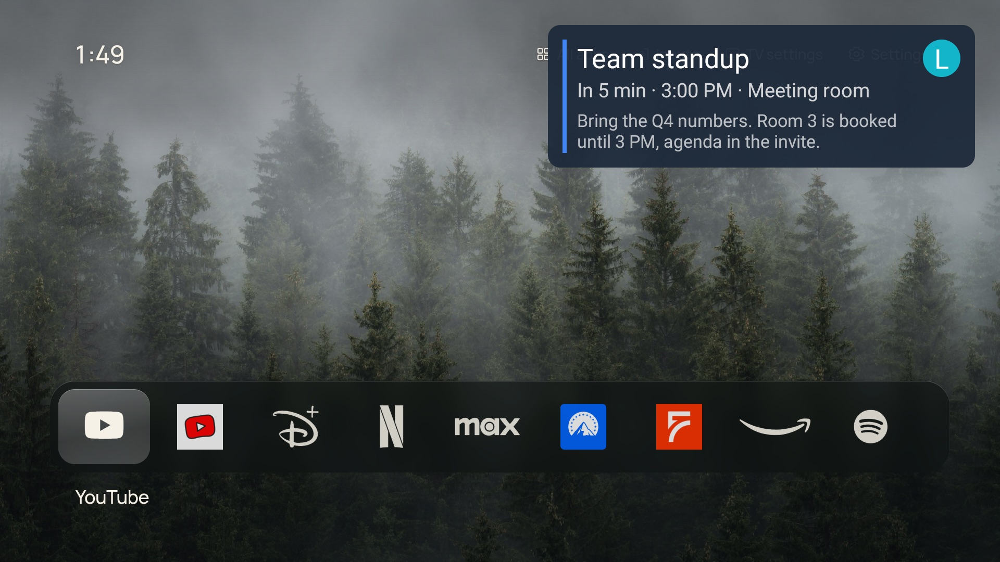
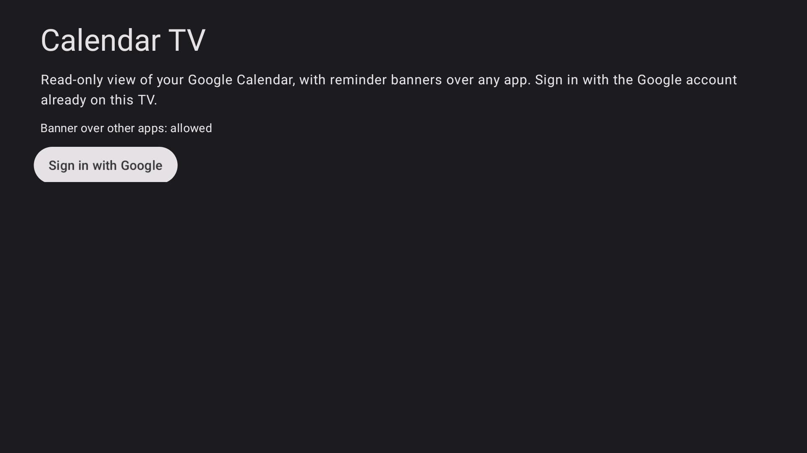
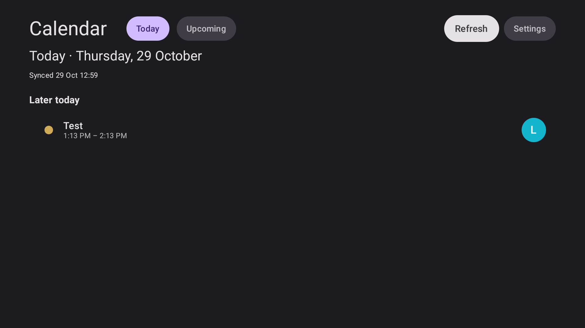
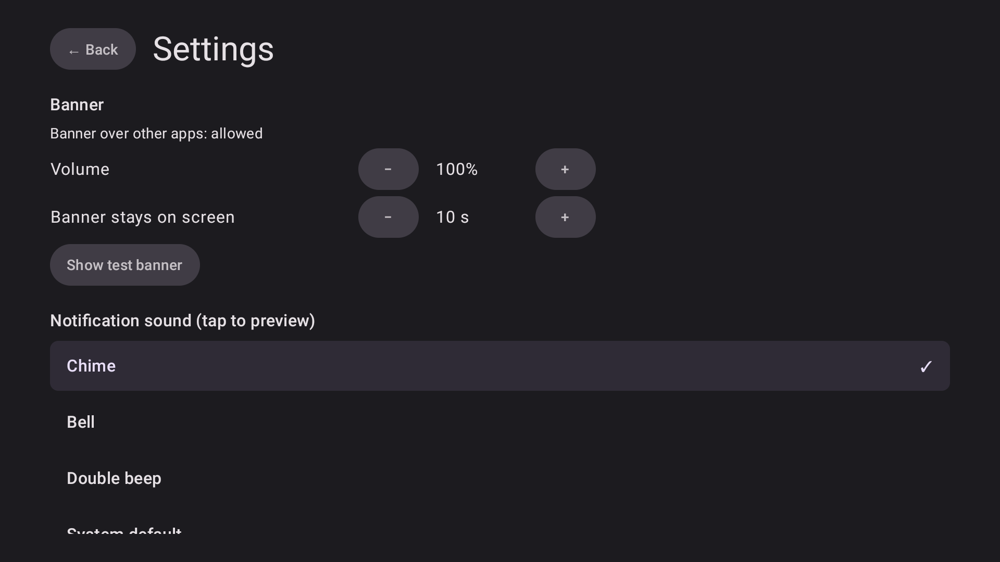

# Calendar TV

A read-only Google Calendar for Android TV that **tells you when something is about to start, on top of whatever is on screen**, the way your phone does.



## The problem

A TV is often the one screen everybody in the room is looking at, and the one place your phone's reminders don't reach:

- You're watching a match or a series with the phone in another room, and the "call starts in 10 minutes" notification never reaches you.
- Android TV has no real calendar app, and it doesn't show notifications from third-party apps as pop-ups. They only pile up in a panel nobody opens.
- Shared screens (a living room, a small office or shop) have no common place to see "what's happening today".

## The solution

Calendar TV connects to the Google account(s) already signed in on the TV and does two things:

1. **Shows your agenda on the TV**: a *Today* screen as the landing view, and an *Upcoming* list for the next 30 days.
2. **Pops a reminder banner over any app** (Netflix, YouTube, live TV…) when an event is about to start, with a sound. The banner doesn't steal the remote: the app underneath keeps working and the banner disappears on its own.

It reads Google Calendar only. It can't create, edit or delete events, so it is safe to leave running on a shared TV.

## How it looks

| Sign in | Today |
| --- | --- |
|  |  |



- **Today** groups events as *All day*, *Happening now*, *Later today* and *Finished* (dimmed). Each event shows a small image of the Google account it belongs to at the right: the account's profile photo once you allow it, otherwise a colored circle with its initial.
- **Banner**: title, how soon it starts, time and place, the event description when there is one, and the account image. It appears for a few seconds (configurable) and plays a sound.

## Features

- Several Google accounts at once (for example a personal and a work calendar); choose which calendars to show.
- Reminders follow what you set in Google Calendar: any offset, in minutes, hours or days before, per event or the calendar default.
- Banner shows over other apps, with the event description and account image.
- Choice of sound (three bundled plus the TV's own sounds), volume and how long the banner stays.
- Reminders keep working with the app closed and are re-armed after a reboot or a clock/timezone change.
- Event detail screen: time, place, calendar and account, reminders, guests and description.

## Limitations

- **Read-only** by design, in this first phase.
- **Not instant**: the TV checks Google every 15 minutes (Android's minimum for background checks). An event you create or move on your phone can take up to that long to appear, and an event created less than that before its reminder may be missed. Pressing *Refresh* syncs right away.
- **Needs Google Play Services**: it works on Android TV / Google TV, not on Fire TV or TVs without Google services.
- **Banner permission**: drawing over other apps needs the "display over other apps" permission. Some TVs hide that settings screen. On the test TV it's granted with one adb command (see below).
- **Nothing shows while the TV is off.** Reminders that come due during standby appear when it wakes up.
- **Unverified Google app**: until the app passes Google's verification, only accounts listed as test users can sign in, and access must be granted again every 7 days.
- Tested on one TV so far: a Haier 4K Android TV running Android 11.

## How it works

```text
Google Calendar API ──> sync (every 15 min) ──> local database ──> Today / Upcoming screens
                                                      │
                                                      └──> next reminder ──> alarm ──> banner over any app + sound
```

- **Sync**: for each connected account the app asks Google Play Services for read-only calendar access (no password, no secrets stored), downloads the next 30 days of events, and rebuilds the reminder list.
- **Reminders**: exactly one alarm is armed at a time, for the earliest upcoming reminder. When it fires, the app shows the banner for everything that is due and arms the next one.
- **Banner**: a small overlay window that can't take focus or touch, so it never interrupts what you are watching.

Stack: Kotlin, Jetpack Compose for TV, Room, WorkManager, DataStore, Google Play Services Auth, OkHttp.

## Running it

You need JDK 17, the Android SDK (platform 35), and an Android TV with network adb enabled.

**1. Google Cloud (once).** In a Google Cloud project: enable the *Google Calendar API*; configure the OAuth consent screen as *External / Testing* and add your Google accounts as test users (scope `calendar.readonly`; `profile` is used for account photos); create an **OAuth client of type Android** with package `palacios.top.calendartv` and the SHA-1 of the key you sign with. No client secret, API key or `google-services.json` is needed.

```bash
keytool -list -v -keystore ~/.android/debug.keystore -alias androiddebugkey -storepass android | grep SHA1
```

**2. Build and install.**

```bash
export JAVA_HOME=/path/to/jdk17
./gradlew testDebugUnitTest assembleDebug
adb connect <tv-ip>:5555
adb install -r app/build/outputs/apk/debug/app-debug.apk
adb shell appops set palacios.top.calendartv SYSTEM_ALERT_WINDOW allow   # banner over other apps
```

**3. First run.** Open *Calendar TV* from the TV's app row **once** (Android delays alarms of apps that were never opened), press *Sign in with Google*, choose an account and allow calendar access. Use *Settings → Show test banner* to check the banner and sound, and *Settings → Update account photos* to show profile photos.

Reminder sound plays through the TV's main volume, so it follows the remote's volume and stays silent if the TV is muted.

## Status and next steps

A working prototype, tested on one TV. To let anyone install and use it, the remaining work is mostly outside the code: Google's verification of the calendar permission, release signing (with its own OAuth client), a privacy policy, a guided first-run for the banner permission, and testing on more TV models. Google Play's rules for apps that draw over other apps are the main open risk for a store release.

Developer notes (commands, architecture and device quirks) are in [CLAUDE.md](CLAUDE.md).
